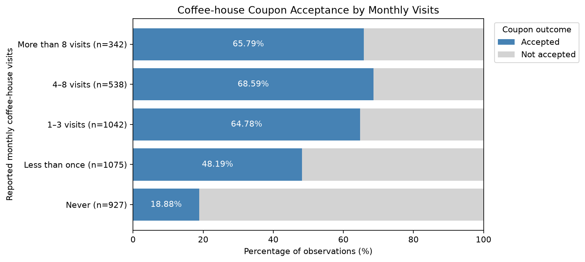

# Will the customer accept a coffee-house coupon?
I investigated how reported coffee-house visits, travel time, temperature, and weather relate to coupon acceptance. The guided bar analysis was the starting point for this investigation.

The [survey data](data/coupons.csv) comes from the UCI Machine Learning Repository and was collected through Amazon Mechanical Turk. Respondents imagined driving scenarios; acceptance meant saying yes to using a coupon right away or before expiry.

## What I expected
- Visit habits and travel time - coffee-house visitors and those with shorter trips may be more likely to accept.
- Temperature and weather - acceptance may vary with temperature, and rain or snow may make a trip less appealing.

## Findings
- Overall acceptance - `49.92%` of the 3,996 coffee-house offers were accepted, compared with `56.84%` across all 12,684 coupon offers.
- Visit habits - acceptance was `18.88%` among those reporting no coffee-house visits (927 observations), compared with `68.59%` for 4–8 monthly visits (538 observations). More visits did not always mean higher acceptance.
- Shorter trips - acceptance was `54.81%` for trips under 15 minutes (1,923 observations), compared with `34.52%` for trips of at least 25 minutes (310 observations).
- Temperature and weather - acceptance was higher at 80°F than at 30°F or 55°F. Snowy offers had lower acceptance than sunny offers, but rainy offers had higher acceptance.

## Limitations
- Survey responses - hypothetical answers do not show actual coupon use or prove cause and effect. The same respondent may appear more than once.
- Missing visit information - 72 observations were excluded from the visit comparison only.
- Temperature and weather overlap - all rainy offers were at 55°F and all snowy offers were at 30°F, so the separate comparisons cannot tell which factor explains the differences.

## Recommendations
- Start with a small test - focus on nearby offers for coffee-house visitors, based on the separate findings. Their combined performance still needs to be checked.
- Avoid weather-only decisions - these comparisons are not enough to base offers on temperature or weather alone.

## Next steps
- Check the combination - compare visit habits among offers with similar travel times.
- Time of day - compare 7AM and 10AM separately with later offers. Morning offers may fit a coffee routine.
- Coupon expiration - compare 2-hour and 24-hour offers. More time may make a coupon easier to use.

The [notebook](assignment.ipynb) contains the code, cleaning decisions, and full comparisons. For local setup, see [DEVELOPMENT.md](DEVELOPMENT.md).
